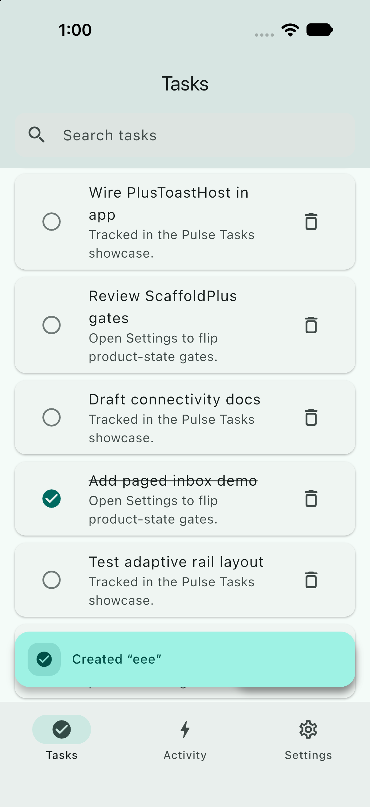
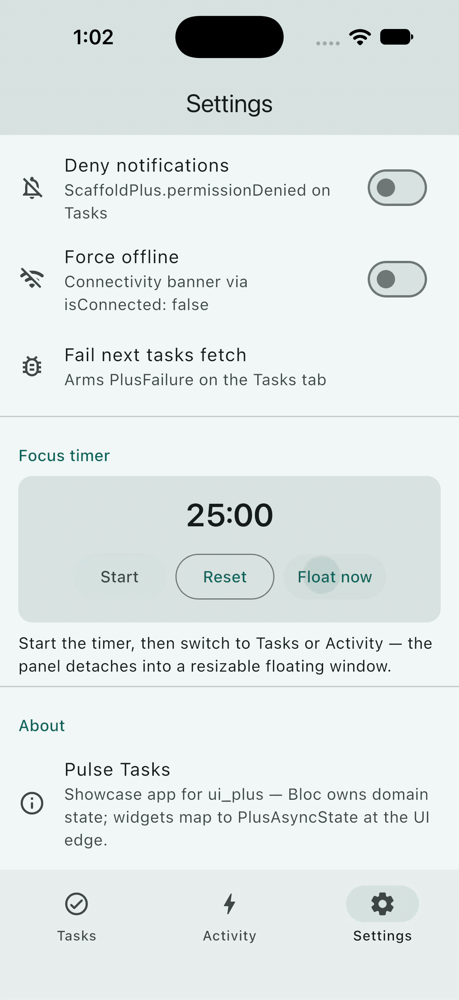
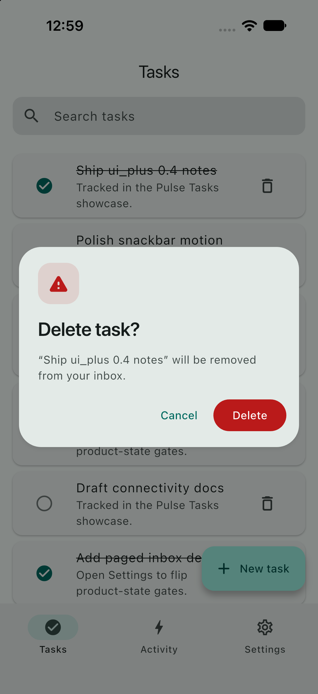
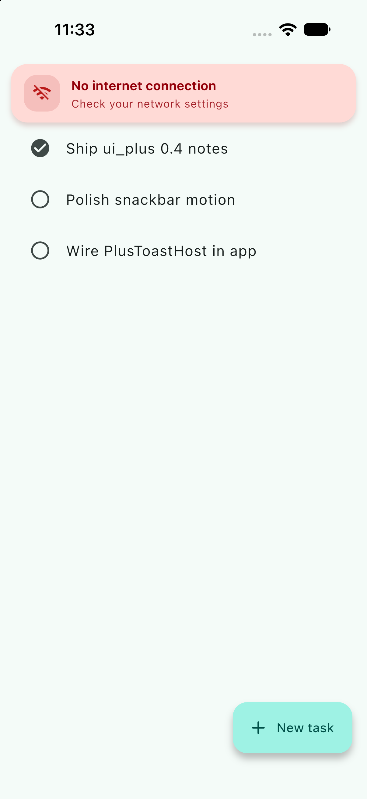
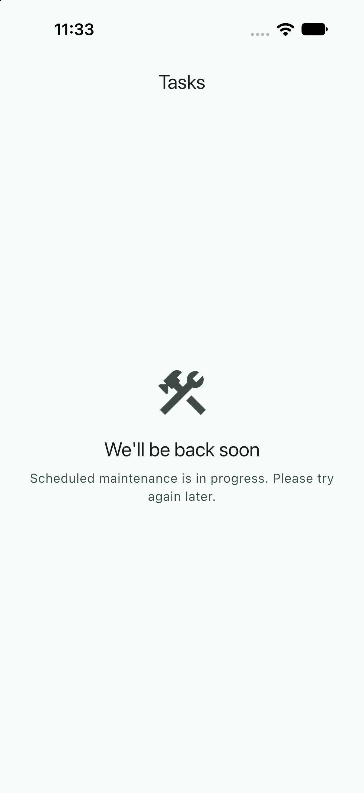
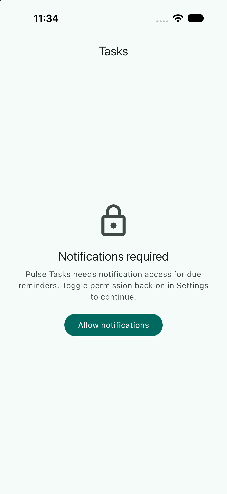
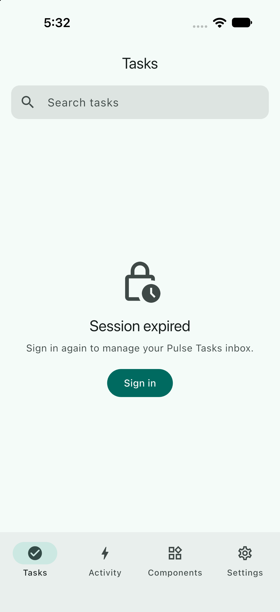
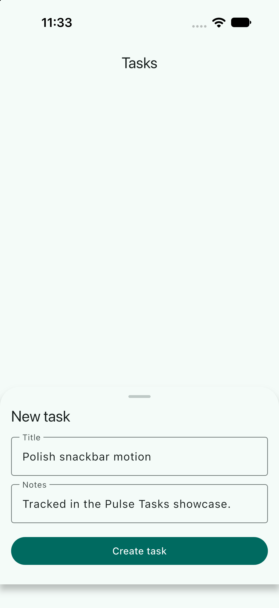

# UI Plus

[![License: MIT][license_badge]][license_link]
[![Docs][docs_badge]][docs_link]
[![pub package][pub_badge]][pub_link]

**More power to your Flutter UI.**

A collection of reusable Flutter UI components, application states,
connectivity features and productivity utilities — without locking developers
into an architecture.

**Docs:** [lidhincs.github.io/ui_plus][docs_link] (guides + API reference).

## Goals

- Architecture-agnostic core (no Bloc, Riverpod, Provider, GetX, or networking clients)
- Composable widgets that work independently
- Flutter-native APIs with Material 3 theming and accessibility in mind
- Lightweight, tested, and documented public surface

## Status

**v1.3.0** — stable public API plus floating-window (PiP) overlay,
`PlusFeedback`, `PlusErrorBoundary`, and an example **Components** gallery.
Built on Flutter 3.47+ / [`material_ui`](https://pub.dev/packages/material_ui),
with inline connectivity banners below the app bar. Flagship entry is
`ScaffoldPlus`; building blocks remain independently reusable.

| Component | Status |
| --- | --- |
| `ScaffoldPlus` | Available |
| `PlusAsyncView` | Available |
| `PlusConnectivityConfig` | Available |
| `PlusConnectivityBanner` / Overlay | Available |
| `PlusInternetChecker` | Available |
| `PlusOfflineState` | Available |
| `PlusConnectivityBuilder` | Available |
| `PlusEmptyState` | Available |
| `PlusErrorState` | Available |
| `PlusErrorBoundary` | Available |
| `PlusLoader` | Available |
| `PlusSkeleton` | Available |
| `PlusSnackbar` | Available |
| `PlusFeedback` | Available |
| `PlusToastHost` | Available |
| `PlusFloatingWindowHost` / `PlusFloatingWindow` | Available |
| `PlusDialog` | Available |
| `PlusConfirmationDialog` | Available |
| `PlusBottomSheet` | Available |
| `PlusSearchField` | Available |
| `PlusRefreshIndicator` | Available |
| `PlusTheme` | Available |
| `PlusAsyncButton` | Available |
| `PlusPagedList` | Available |
| `PlusAdaptiveScaffold` | Available |
| `PlusMaintenanceMode` | Available |
| `PlusPermissionState` | Available |
| `PlusSessionExpired` | Available |

## Preview

Pulse Tasks example (Bloc showcase):

<!-- HTML table + width=100% so equal columns; GIF/PNG intrinsic sizes match (1206px). -->
<table>
  <tr>
    <th>Toast</th>
    <th>Floating window</th>
    <th>Dialog</th>
  </tr>
  <tr>
    <td></td>
    <td></td>
    <td></td>
  </tr>
</table>

| Offline banner | Maintenance | Permission |
| --- | --- | --- |
|  |  |  |

| Session expired | Compose | |
| --- | --- | --- |
|  |  | |

## Installation

Requires Flutter `>=3.47.0` and Dart `^3.13.0`. Material widgets come from
[`material_ui`](https://pub.dev/packages/material_ui) (not
`package:flutter/material.dart`).

```sh
dart pub add ui_plus material_ui
```

```dart
import 'package:material_ui/material_ui.dart';
import 'package:ui_plus/ui_plus.dart';
```

## Quick start

Drop-in scaffold (async opt-in):

```dart
ScaffoldPlus<List<Item>>(
  appBar: AppBar(title: const Text('Items')),
  state: state,
  useSkeleton: true,
  isEmpty: (items) => items.isEmpty,
  onRetry: reload,
  bodyBuilder: (context, items) => ItemList(items: items),
)
```

Plain scaffold usage (no async state — `body` works like Flutter's `Scaffold`):

```dart
ScaffoldPlus<void>(
  appBar: AppBar(title: const Text('Home')),
  body: const HomeView(),
)
```

### Example app

**Pulse Tasks** is a Bloc showcase inbox with a **Components** tab for
per-widget demos:

```sh
cd example
flutter pub get
flutter run
```

Cubits own domain state; widgets map to `PlusAsyncState` at the UI edge.

- **Components** — live demos of each public `ui_plus` widget and what it does
- **Settings → Developer gates** — maintenance, session, permission, offline
- **Settings → Focus timer** — `PlusFloatingWindow` (float while switching tabs)

Walkthrough: [docs][docs_pulse_link].

## Components

### ScaffoldPlus

Flagship drop-in replacement for Flutter's `Scaffold` with optional async body
rendering. Composes a native `Scaffold` internally (so `Scaffold.of` works).

**Body precedence:** `maintenanceMode` → `sessionExpired` → `permissionDenied`
→ async `state` → `body`. Product states also suppress the FAB.

**Async options:** `state`, `bodyBuilder`, `isEmpty`, `onRetry`, `onRefresh`,
`onRefreshError`, `loadingBuilder`, `emptyBuilder`, `errorBuilder`,
`useSkeleton`, `skeletonBuilder`.

Shares the same internal async renderer as `PlusAsyncView`.

**Connectivity (opt-in):** banner sits in the scaffold **body** (below the app
bar) by default and pushes content down. Use
`PlusConnectivityBannerLayout.overlay` for a floating banner.

```dart
ScaffoldPlus(
  connectivityBanner: true, // built-in check + inline layout by default
  body: const HomePage(),
)

ScaffoldPlus(
  connectivityBanner: true,
  isConnected: isConnected, // custom source always wins
  connectivityStream: connectivityStream,
  body: const HomePage(),
)
```

**Product states (opt-in):**

```dart
ScaffoldPlus(
  maintenanceMode: isUnderMaintenance,
  sessionExpired: isSessionExpired,
  permissionDenied: !cameraGranted,
  body: const HomePage(),
)
```

Standalone widgets: `PlusMaintenanceMode`, `PlusSessionExpired`,
`PlusPermissionState`.

**Pull-to-refresh** on async success/empty via `onRefresh` / `onRefreshError`
(success body should be scrollable).

### PlusAsyncView

Switches loading / failure / empty / success from `PlusAsyncState<T>` inside an
existing layout. Prefer `ScaffoldPlus` when you want scaffold + async together.

```dart
PlusAsyncView<User>(
  state: state,
  isEmpty: (user) => user.items.isEmpty,
  onRetry: reload,
  builder: (context, user) => UserProfile(user: user),
)
```

### State widgets

```dart
const PlusEmptyState(title: 'Nothing here yet')
const PlusErrorState(title: 'Something went wrong')
const PlusLoader()
const PlusSkeleton(height: 16)

// Replace the red ErrorWidget once at startup:
void main() {
  PlusErrorBoundary.install();
  runApp(const MyApp());
}
```

### Connectivity

```dart
PlusConnectivityOverlay(
  isConnected: isConnected,
  connectivityStream: stream,
  child: child,
)

PlusConnectivityBuilder(
  isConnected: isConnected,
  onlineBuilder: (context) => const HomePage(),
  offlineBuilder: (context) => const PlusOfflineState(),
)
```

Also: `PlusInternetChecker` (plugin-free reachability), `PlusConnectivityBanner`,
`PlusConnectivityConfig` / `PlusConnectivityBannerLayout`.

### Floating window

```dart
MaterialApp(
  builder: (context, child) => PlusFloatingWindowHost(
    child: PlusToastHost(child: child!),
  ),
  home: const HomePage(),
);

PlusFloatingWindow(
  controller: controller,
  title: 'Focus timer',
  builder: (context, {required floating}) => TimerView(compact: floating),
);
```

Detach on navigate while active; drag / resize / dismiss in the host overlay
(see preview GIF above). Guide:
[floating window](https://lidhincs.github.io/ui_plus/guides/floating-window/).

### Feedback

```dart
await PlusFeedback.run(
  action: () => save(),
  successMessage: 'Saved',
);

PlusSnackbar.success(context: context, message: 'Saved');
PlusSnackbar.error(message: 'Failed'); // with PlusToastHost

MaterialApp(
  scaffoldMessengerKey: PlusToastHost.messengerKey,
  builder: (context, child) => PlusToastHost(child: child!),
  home: const HomePage(),
);

await PlusDialog.alert(context, title: 'Offline', message: 'Try again.');
final ok = await PlusConfirmationDialog.show(
  context,
  title: 'Delete?',
  isDestructive: true,
);
await PlusBottomSheet.show(
  context: context,
  title: 'Share',
  builder: (context) => const ShareSheet(),
);
```

### Productivity

```dart
PlusSearchField(
  hintText: 'Search',
  onChanged: filter,
)

PlusAsyncButton(
  onPressed: () async => save(),
  child: const Text('Save'),
)

PlusPagedList<Item>(
  items: items,
  hasMore: hasMore,
  isLoadingMore: isLoadingMore,
  onLoadMore: fetchNext,
  itemBuilder: (context, item, index) => ItemTile(item: item),
)

PlusAdaptiveScaffold(
  destinations: destinations,
  selectedIndex: index,
  onDestinationSelected: onSelect,
  body: pages[index],
)

PlusRefreshIndicator(onRefresh: reload, child: list)

ThemeData(
  extensions: const [
    PlusTheme(snackbarDuration: Duration(seconds: 3)),
  ],
)
```

## Versioning

UI Plus follows [Semantic Versioning](https://semver.org/):

- **MAJOR** — breaking public API changes (documented in CHANGELOG)
- **MINOR** — new features / non-breaking enhancements
- **PATCH** — bug fixes and docs

Import only `package:ui_plus/ui_plus.dart`. Do not import `src/`.

## Migrating from 0.5.x

`1.0.0` freezes the `0.6.0` surface. From `0.5.x`:

1. Add `material_ui` and switch Material imports (or run
   `dart fix --apply --code=migrate_design_widgets`).
2. Expect the connectivity banner **below the app bar** (inline). Restore the
   old floating behavior with
   `layout: PlusConnectivityBannerLayout.overlay`.

See [CHANGELOG](CHANGELOG.md) for full notes.

## License

MIT — see [LICENSE](LICENSE).

[docs_badge]: https://img.shields.io/badge/docs-GitHub%20Pages-teal
[docs_link]: https://lidhincs.github.io/ui_plus/
[docs_pulse_link]: https://lidhincs.github.io/ui_plus/example/pulse-tasks/
[license_badge]: https://img.shields.io/badge/license-MIT-blue.svg
[license_link]: https://opensource.org/licenses/MIT
[pub_badge]: https://img.shields.io/pub/v/ui_plus.svg
[pub_link]: https://pub.dev/packages/ui_plus
