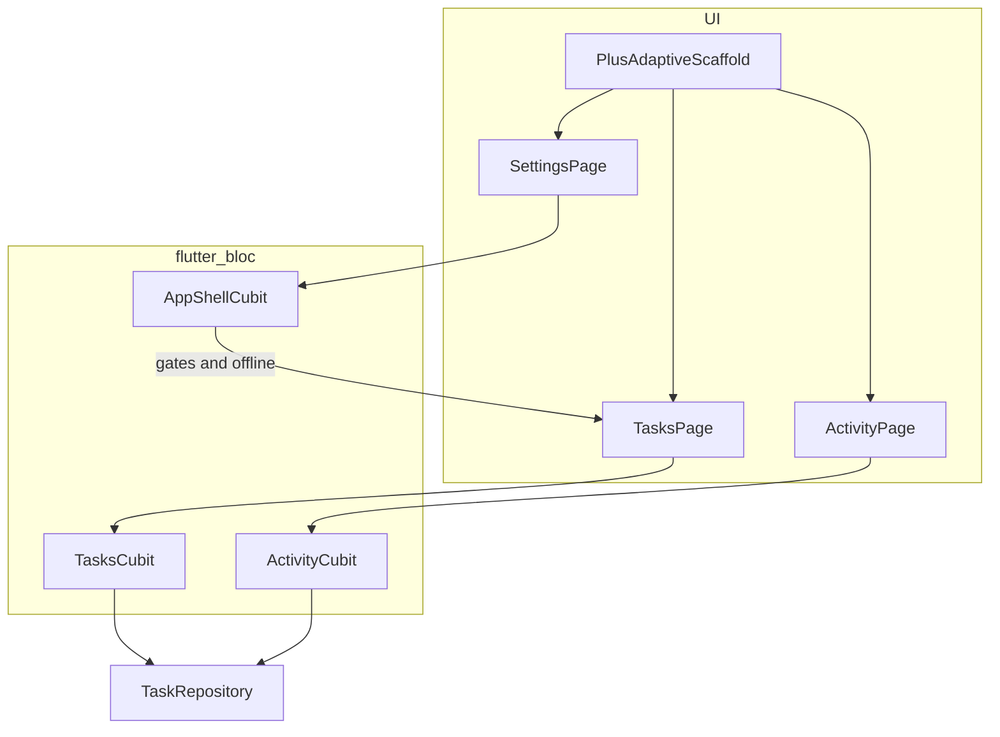

# Pulse Tasks

A small **Bloc**-powered task inbox that showcases `ui_plus` in one coherent
app. Source: [`example/`](https://github.com/LidhinCS/ui_plus/tree/main/example).

!!! tip "Run it"
    ```sh
    cd example
    flutter pub get
    flutter run
    ```

    Then open **Settings → Developer gates** to flip product states live.

    pub.dev screenshots for this flow live in `screenshots/` at the package
    root (regenerate with `tool/capture_screenshots.sh`).

## What it demonstrates

| Flow | ui_plus APIs |
| --- | --- |
| Adaptive shell | `PlusAdaptiveScaffold` |
| Tasks inbox | `ScaffoldPlus`, `PlusAsyncState`, skeleton / empty / error, `onRefresh` |
| Search + paging | `PlusSearchField`, `PlusPagedList` |
| Create / delete | `PlusBottomSheet`, `PlusAsyncButton`, `PlusConfirmationDialog` |
| Global toasts | `PlusToastHost`, `PlusSnackbar` (from Cubits, no context) |
| Connectivity | Built-in checker + inline banner below app bar (Settings “Force offline”) |
| Product gates | Maintenance / session / permission toggles |
| Activity feed | Second `ScaffoldPlus` + Cubit mapping |

## Architecture



**Rule:** Cubits own domain state. Widgets map to `PlusAsyncState` at the UI
edge. Core `ui_plus` stays free of Bloc.

| File | Role |
| --- | --- |
| `lib/main.dart` | `PlusToastHost`, theme, `MultiBlocProvider` |
| `lib/app.dart` | `PlusAdaptiveScaffold` shell |
| `lib/data/task_repository.dart` | Fake API — latency, paging, search, failures |
| `lib/cubit/tasks_cubit.dart` | Inbox load / search / page / mutate |
| `lib/cubit/app_shell_cubit.dart` | Tabs + developer gates |
| `lib/features/tasks/tasks_page.dart` | `ScaffoldPlus` + `PlusPagedList` |

## Key patterns in code

### Map Cubit → ScaffoldPlus

`TasksCubit` already exposes `PlusAsyncState` on `TasksState.status`. The page
passes it straight through:

```dart
BlocBuilder<TasksCubit, TasksState>(
  builder: (context, tasksState) {
    return ScaffoldPlus<List<Task>>(
      state: tasksState.status,
      useSkeleton: true,
      isEmpty: (items) => items.isEmpty,
      onRetry: () => context.read<TasksCubit>().load(),
      onRefresh: () => context.read<TasksCubit>().refresh(),
      bodyBuilder: (context, items) => PlusPagedList<Task>(
        items: items,
        hasMore: tasksState.hasMore,
        isLoadingMore: tasksState.isLoadingMore,
        onLoadMore: () => context.read<TasksCubit>().loadMore(),
        itemBuilder: (context, task, index) => TaskTile(task: task),
      ),
    );
  },
)
```

### Global snackbars from Cubits

```dart
// main.dart
MaterialApp(
  scaffoldMessengerKey: PlusToastHost.messengerKey,
  builder: (context, child) => PlusToastHost(child: child!),
  // ...
)

// tasks_cubit.dart — no BuildContext
PlusSnackbar.success(message: 'Created “${task.title}”');
```

### Product gates from shell state

```dart
final shell = context.watch<AppShellCubit>().state;

ScaffoldPlus(
  maintenanceMode: shell.maintenanceMode,
  sessionExpired: !shell.isSignedIn,
  permissionDenied: !shell.notificationsAllowed,
  isConnected: shell.forceOffline ? false : null,
  useBuiltInInternetCheck: !shell.forceOffline,
  // ...
)
```

Settings keeps gates off on purpose so you can always turn them back off.

## Suggested walkthrough

1. **Tasks** — wait for skeleton → list; pull to refresh; scroll to load more.
2. Tap **New task** — bottom sheet + `PlusAsyncButton`; watch the global toast.
3. Delete a task — confirmation dialog (destructive).
4. **Settings → Force offline** — connectivity banner on Tasks / Activity.
5. Toggle **Maintenance** / **Deny notifications** / **Sign out** — gated UIs.
6. **Fail next tasks fetch** — return to Tasks and retry to see `PlusFailure`.

## Related guides

- [State management](../guides/state-management.md) — Bloc / Riverpod mapping
- [ScaffoldPlus](../guides/scaffold-plus.md) — gates and async body
- [Feedback & toasts](../guides/feedback.md) — `PlusToastHost`
- [Lists, search & shell](../guides/productivity.md) — paging and adaptive nav
